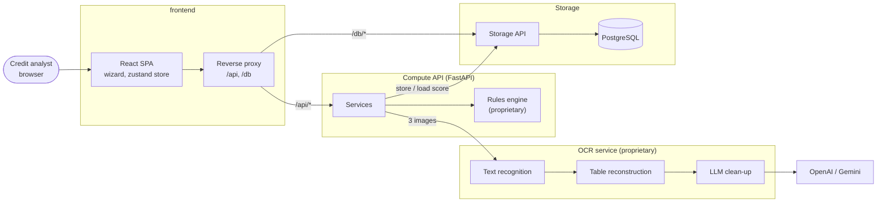
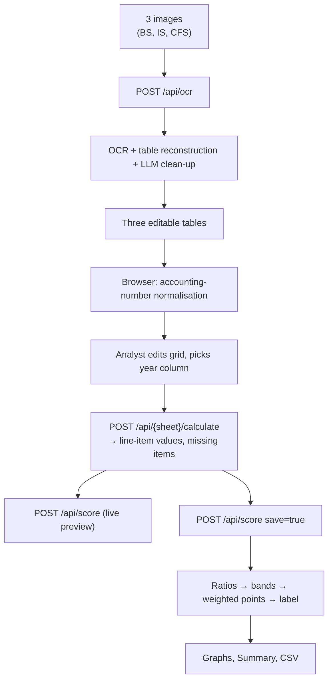
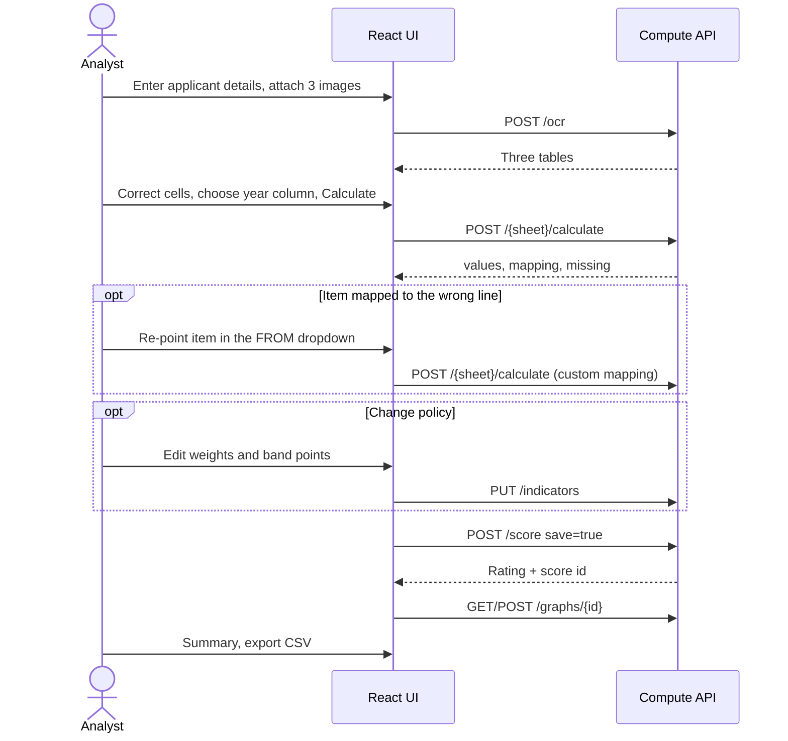

# International Credit Risk Rating System

An OCR- and LLM-assisted system that turns images of a company's **balance sheet, income statement and cash flow statement** into a transparent, rule-based **quantitative credit rating**, with every extracted figure, mapping, ratio and weight visible to and editable by the analyst.

The project is built by **Team ONNESHX** for the AI Builder Cup.

Project write-up: [PROJECT_SLIDES.md](PROJECT_SLIDES.md)

---

## About This Repository

This is a **submission version**. The core of the system is proprietary and is left out:

- the OCR and table-reconstruction pipeline
- the LLM prompts, model settings and line-item mapping
- the ratio formulas, indicator weights, scoring bands and rating logic
- the storage service, database schema and recorded sample data

What is included:

| Part | Location | Contents |
|---|---|---|
| Frontend | `frontend/` | Full React + TypeScript (Vite) app: the guided wizard, editable tables, charts and summary |
| API surface | `api/main.py`, `api/schemas.py` | Every compute endpoint and its request and response models |
| Service interface | `api/services.py` | Function signatures only; each raises `NotImplementedError` |

The backend in this repository does not run on its own. A live demo or a walkthrough of the full system is available on request.

---

## Table of Contents

1. [Overview](#1-overview)
2. [Problem Statement and Motivation](#2-problem-statement-and-motivation)
3. [Solution Summary and Key Differentiators](#3-solution-summary-and-key-differentiators)
4. [Key Features](#4-key-features)
5. [System Architecture](#5-system-architecture)
6. [Architecture Diagrams](#6-architecture-diagrams)
7. [Technology Stack](#7-technology-stack)
8. [Repository Structure](#8-repository-structure)
9. [Feature Walkthrough](#9-feature-walkthrough)
10. [AI/ML Approach](#10-aiml-approach)
11. [Scoring Approach](#11-scoring-approach)
12. [API Overview](#12-api-overview)
13. [Running the Frontend](#13-running-the-frontend)
14. [Usage Walkthrough](#14-usage-walkthrough)
15. [Testing and Quality Assurance](#15-testing-and-quality-assurance)
16. [Security and Data Handling](#16-security-and-data-handling)
17. [Known Limitations](#17-known-limitations)
18. [Roadmap](#18-roadmap)
19. [Team and Acknowledgments](#19-team-and-acknowledgments)
20. [License and Contact](#20-license-and-contact)

---

## 1. Overview

Credit analysts at lending institutions receive financial statements as scanned pages or screenshots. Before any judgement can be made, the figures must be transcribed, matched to standard line items, turned into ratios, compared against policy thresholds and weighted into a score.

This system automates that chain while keeping the analyst in control:

| Stage | Performed by | Nature |
|---|---|---|
| Text detection and recognition | OCR model | ML model |
| Table reconstruction | Proprietary layout algorithm | Deterministic |
| Table clean-up | LLM (OpenAI or Google Gemini) | LLM, deterministic settings |
| Review and correction of extracted tables | Analyst, in an editable grid | Human-in-the-loop |
| Line-item mapping | Default dictionary, manual re-mapping, optional LLM suggestion | Deterministic by default |
| Financial ratios, banding, weighting | Proprietary rules engine | Deterministic business rules |
| Visualisation, summary and CSV export | Server-built charts, React UI | Deterministic |

**The rating itself is never produced by an AI model.** AI is used only to read the documents; every number that contributes to the score is computed by fixed formulas and can be traced back to a specific cell in the reviewed table.

## 2. Problem Statement and Motivation

- **Manual transcription is slow and error-prone.** Statements contain dozens of lines and multiple year columns, and figures use accounting notation such as `(1,234,567)` for negatives.
- **Line names are not standardised.** One company reports "Net cash from/(used in) operating activities", another "Cash generated from operating activities". Ratios require a fixed vocabulary.
- **Scoring rules are policy, not opinion.** Credit-rating frameworks define bands and weights that must be applied consistently and auditably.
- **Black-box scoring is unacceptable in lending.** An analyst must be able to explain every point awarded or withheld.

## 3. Solution Summary and Key Differentiators

1. **Guided eight-step wizard** from applicant details to final summary, with step locking so that no page renders without the data it depends on.
2. **AI confined to extraction.** OCR and LLM clean-up produce a table; the analyst corrects it; deterministic code does the rest.
3. **Visible failure modes.** Items that could not be found are listed as missing, and the UI raises a specific warning when nearly all items are missing, distinguishing a wrong *particulars* column from a wrong *year* column.
4. **Editable policy.** Indicator weights and points per band can be changed through the UI with server-side validation.
5. **Offline-capable demo mode.** A recorded extraction can be replayed, so the full rating chain runs without GPU, OCR models or API keys.
6. **Service separation.** OCR, compute and storage are separate services, so the heavy OCR stack never has to be installed to run scoring.

## 4. Key Features

| Feature | Status |
|---|---|
| Applicant details form with validation | Implemented |
| Upload of three statement images (drag-and-drop) | Implemented |
| OCR + LLM table extraction service | Implemented (not included) |
| Saved-extraction replay mode | Implemented (not included) |
| Editable statement grids with accounting-number normalisation | Implemented |
| Year-column selection and per-item re-mapping | Implemented |
| Ratios across six categories with live preview | Implemented |
| Editable indicator weights and band points | Implemented |
| LaTeX formula display | Implemented |
| Analysis charts (summary, categories, ratios) | Implemented |
| Summary page with CSV export and "start over" | Implemented |
| Persistence of statements and scores | Implemented (not included) |
| Session persistence across browser refresh | Implemented |
| Qualitative questionnaire | Backend implemented; UI off the main flow |
| Authentication / multi-tenant access control | Not implemented |
| PDF input | Not implemented (images only) |

## 5. System Architecture

The full system is composed of five runtime components:

| Service | Responsibility | In this repo |
|---|---|---|
| `frontend` | Wizard UI; reverse-proxies `/api` and `/db` | Yes |
| `api` | Compute API: OCR orchestration, statement resolution, ratios, scoring, formulas, weights, graphs | Interface only |
| `ocr` | Text recognition, table reconstruction, LLM clean-up | No |
| `db_api` | Storage API | No |
| `db` | PostgreSQL | No |

The browser only ever talks to the frontend origin. In development, Vite proxies `/api` and `/db` to the backend services; in Docker, nginx does the same.

## 6. Architecture Diagrams

### 6.A High-Level System Architecture



### 6.B End-to-End Data Flow



### 6.C Analyst Workflow



## 7. Technology Stack

| Layer | Technology |
|---|---|
| UI | React 19, TypeScript, Vite |
| Routing / state | react-router-dom, zustand (persisted), TanStack Query |
| Data grid | AG Grid Community |
| Charts / maths | Plotly.js (figures built server-side), KaTeX |
| Motion | framer-motion (respects `prefers-reduced-motion`) |
| Lint | oxlint |
| Compute API | FastAPI, Pydantic v2 |
| OCR / LLM | PaddleOCR, OpenAI and Google Gemini |
| Storage | PostgreSQL, SQLAlchemy |
| Delivery | Docker Compose, nginx |

## 8. Repository Structure

```text
.
├── api/
│   ├── main.py         Routes and error handling
│   ├── schemas.py      Pydantic request/response models
│   └── services.py     Service signatures (implementation withheld)
├── frontend/           React + TypeScript SPA
│   └── src/
│       ├── App.tsx, flow.ts, main.tsx
│       ├── api/            HTTP clients, endpoint wrappers, TS types
│       ├── pages/          Home, statement pages, Indicators, Formulas, Graphs, Summary, ...
│       ├── components/     Grid, chart, LaTeX, nav, footer, blocks/
│       ├── store/          zustand store
│       └── lib/numbers.ts  Accounting-number parser
├── PROJECT_SLIDES.md
└── README.md
```

## 9. Feature Walkthrough

### 9.1 Guided Wizard and Step Locking

`frontend/src/flow.ts` defines the steps (Applicant → Balance sheet → Income statement → Cash flow → Weights → Indicators → Analysis → Summary) and derives, from the store, why each step is locked and whether it is done. A step guard renders an explanatory empty state with a link to the earliest actionable step instead of a broken page.

### 9.2 Applicant Details and Upload

Name, address, phone and email fields with inline validation, and three dropzones for the statements. A checkbox allows proceeding with a saved extraction. Applicant details stay in the browser and are not sent to the backend.

### 9.3 Statement Review

- **Normalisation:** `lib/numbers.ts` converts a cell only when the entire cell is an accounting number: `1,234` → `1234`, `(1,234)` → `-1234`. Line names, note references and date headers pass through untouched.
- **Interaction:** an editable grid, a year-column selector and a Calculate button. A "Values used" table shows each line item, its value and the source line, which can be re-pointed with a dropdown.
- **Diagnostics:** when nearly all items are missing, the page says whether to check the year column or the particulars column. A banner appears when the table is edited after calculation.

### 9.4 Indicator Weights

A table of indicators with editable weights and points per band (*Excellent / Good / Marginal / Unacceptable*). Changes are validated on the server.

### 9.5 Ratio Preview and Final Rating

Each ratio is shown with its formula, inputs, the source line of each input, a live value and band, and a "missing only" filter. Continue computes and saves the final rating.

### 9.6 Analysis, Summary and Export

Charts for the overall score, category breakdown and per-ratio results. The summary page shows applicant details, the total and label, every ratio with its band and points, and offers **Export CSV** and **Start over**.

## 10. AI/ML Approach

- **Text recognition** with an OCR model on each statement image.
- **Table reconstruction** from recognised text boxes with a proprietary layout algorithm (no dedicated table-structure model needed).
- **LLM clean-up** fixes broken headers, misspellings and duplicates while preserving row order and adding no new content. Either OpenAI or Gemini can be chosen, with deterministic settings and a fallback to the raw OCR table on error.
- **Optional LLM line-item mapping** suggests which table rows correspond to each required item; anything that does not match the table exactly is reported as missing.

**How AI output is constrained**

- The LLM never produces numbers used in scoring; it only reorganises a table that the analyst then reviews and edits.
- Every value in the score is traceable to a named row and column.
- Raw OCR output is returned alongside the cleaned table for inspection.

## 11. Scoring Approach

The rating is computed from financial ratios grouped into six categories:

- Leverage
- Liquidity
- Profitability
- Coverage
- Operational Efficiency
- Earning Quality

Each ratio is placed in a band (*Excellent, Good, Marginal, Unacceptable*), each band carries points, and the points are summed into a quantitative score with an overall label. Weights and band points are editable policy; the specific formulas, thresholds and default weights are proprietary and are not included in this repository. An optional qualitative questionnaire extends the score to an overall rating.

## 12. API Overview

The full endpoint list and models are in `api/main.py` and `api/schemas.py`. Through the frontend, compute routes are prefixed with `/api`.

| Method | Path | Purpose |
|---|---|---|
| GET | `/health` | Liveness |
| POST | `/ocr` | Upload three statement images |
| POST | `/balance-sheet/calculate` | Resolve balance-sheet items |
| POST | `/income/calculate` | Resolve income-statement items |
| POST | `/cashflow/calculate` | Resolve cash-flow items |
| GET | `/statements/items` | Required items and default mapping |
| GET | `/qualitative/questions` | Questionnaire |
| POST | `/qualitative/score` | Score questionnaire answers |
| POST | `/score` | Ratios, bands, points, totals |
| GET | `/formulas` | Formulas with LaTeX |
| GET / PUT | `/indicators` | Read / replace weights and band points |
| GET | `/graphs` | Available charts |
| GET / POST | `/graphs/{graph_id}` | Chart for a saved or in-memory score |

All errors return `{"detail": "<message>"}` with a standard HTTP status code.

## 13. Running the Frontend

```bash
cd frontend
npm install
npm run dev
```

The UI loads on <http://localhost:5173>. It needs the full backend to fetch data, so without it the screens show their empty and error states.

```bash
npm run lint    # oxlint
npm run build   # type-check + production build
```

## 14. Usage Walkthrough

1. **Applicant** — fill in details; attach the three statement images, or use the saved extraction; submit.
2. **Balance sheet / Income statement / Cash flow** — check each grid against the source image, fix misread cells, select the year column and click *Calculate*. Re-point items if needed.
3. **Weights** — optionally adjust weights and band points and save.
4. **Indicators** — review each ratio's formula, inputs and live band; *Continue* to compute and save the rating.
5. **Analysis** — switch between the summary, category and ratio charts.
6. **Summary** — review the rating, *Export CSV*, or *Start over*.

## 15. Testing and Quality Assurance

The full system has an automated backend test suite covering number parsing, statement resolution, custom mappings, error handling, scoring, weight edits, formulas, charts and the questionnaire; it runs without network services. The suite is part of the withheld code. A manual regression check confirmed identical per-ratio scores before and after the UI rework.

For this repository, the frontend is checked with `npm run lint` and `npm run build`.

## 16. Security and Data Handling

The system is a prototype.

- Secrets are read from environment variables and never committed.
- All request bodies are schema-validated; weight edits are range-checked.
- Browser access to backends goes through a same-origin proxy, with CORS restricted to configured origins.
- In live mode, OCR-derived text is sent to the selected LLM provider; organisations must assess this against their data-protection obligations.
- Applicant details are kept in browser storage until *Start over*.
- Authentication, authorisation and audit logging are not yet in place and are required before handling real customer data.

## 17. Known Limitations

- Unreadable values are listed as missing but the rating still completes, so a partly wrong statement can still produce a plausible-looking score.
- Column detection is heuristic; the analyst may need to choose the particulars or year column.
- Some unusual number formats (e.g. en-dash or trailing-minus negatives) are not parsed.
- Sign conventions from the statement pass straight through and may need correcting in the grid.
- Images only; no PDF or multi-page input.
- Single-year rating; no trend analysis across years.
- Weights are global per deployment, not per user.

## 18. Roadmap

1. Block rating when key items are missing instead of completing with gaps.
2. Detect the particulars and year columns by content.
3. Broaden number parsing.
4. Expose LLM-assisted mapping in the UI for analyst approval.
5. PDF and multi-page input; dedicated table detection.
6. Authentication, role-based access, per-tenant weights and an audit trail.
7. A labelled benchmark for OCR and table reconstruction, and frontend end-to-end tests.

## 19. Team and Acknowledgments

**Team ONNESHX:** Sourav Saha, Ahnaf Samin, Jaasia Anjum and Shamim Rahim.

- Four UI components in `frontend/src/components/blocks/` (upload dropzone, radial gauge, stacked bars, toast stack) are ported from [bencho.dev](https://bencho.dev) under the MIT licence.
- Open-source projects: PaddleOCR, FastAPI, React, AG Grid Community, Plotly, KaTeX, SQLAlchemy, PostgreSQL.

## 20. License and Contact

Copyright (c) 2026 Sourav Saha, Team ONNESHX. All rights reserved.

This is proprietary software. The source code is visible for review and evaluation only. Copying, modifying, distributing, or using it in any product or service requires prior written permission. See the [LICENSE](LICENSE) file for details.

For permission requests or questions, contact the repository owners through the project's hosting platform.
